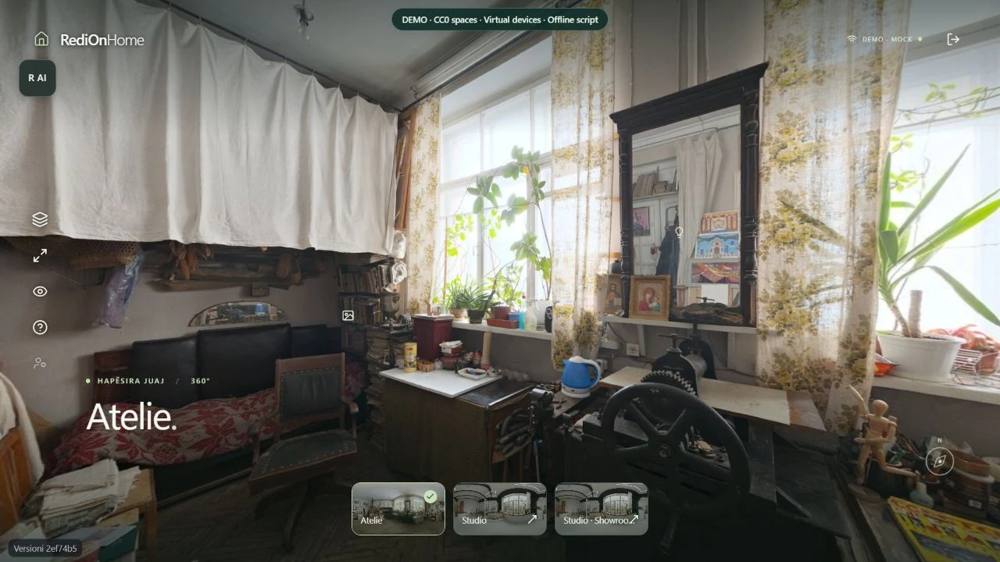
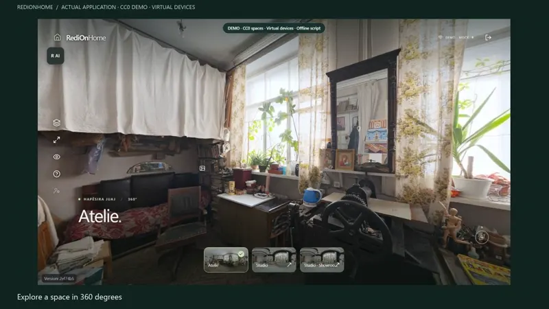
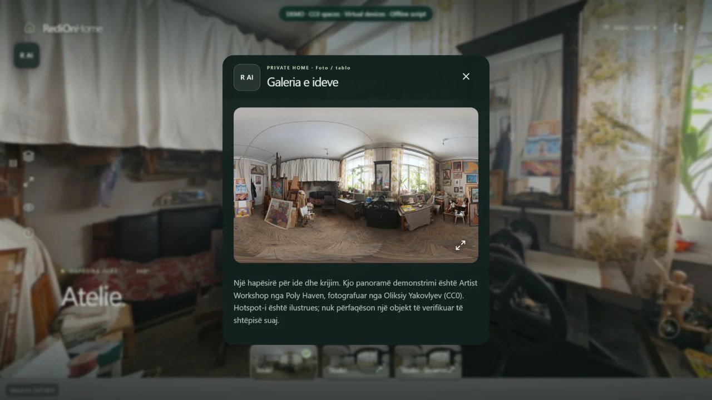
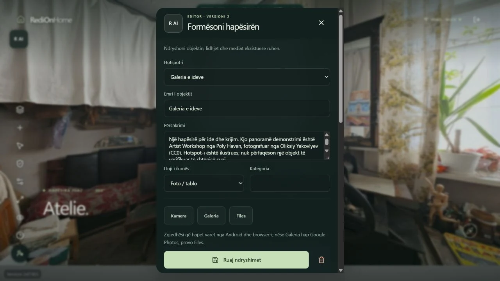
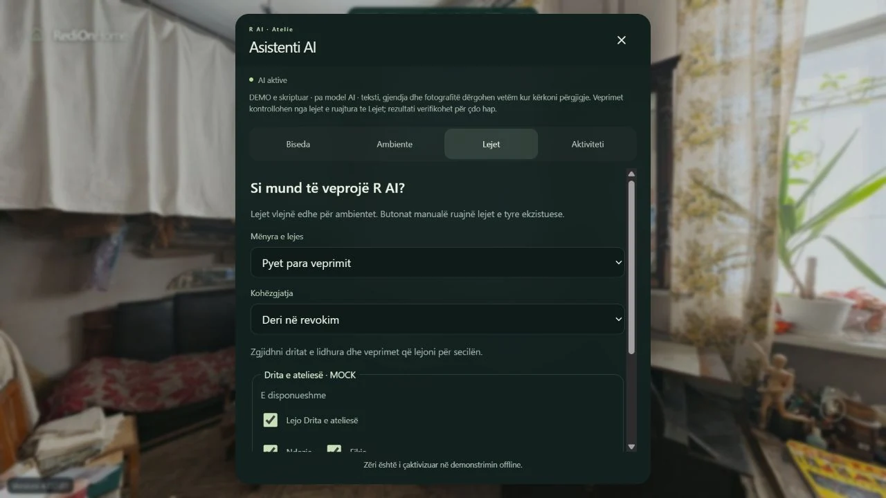
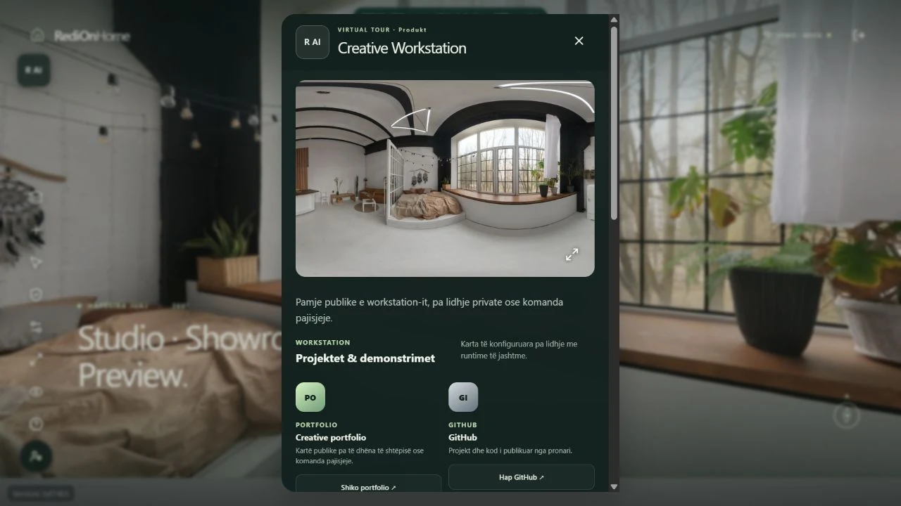

# RediOnHome

**Your space. Connected. Under your control.**

A spatial interface for rooms, content and connected objects: explore in 360°, select an object, edit it in context and deliberately share a separate showroom.

[](https://github.com/IamRedi/redionhome-showcase/actions/workflows/ci.yml)

**React · TypeScript · Photo Sphere Viewer · Express · SQLite · Local-first**



**[Deutsch](README.md)** · [Verification](EVIDENCE.md) · [Architecture](docs/ARCHITECTURE.md) · [Media provenance](docs/MEDIA.md)

## One space, different perspectives

- **Explore a room:** panorama, portals between viewpoints and objects placed in the image. Demo connections are illustrative, not surveyed geometry.
- **Edit in context:** select an object, use the relevant fields, preview and save a revision. Conflicts preserve edits rather than silently overwriting another change.
- **Choose what to share:** Private Home and Showroom use separate object profiles and explicitly selected snapshots. Private edits do not publish automatically.
- **Understand actions:** R AI, Lejet (permissions), Ambiente and Aktiviteti use the existing proposal, permission and execution interface. In this showcase, only virtual devices respond to a clearly labeled offline scripted assistant.

## A short walkthrough

[](docs/assets/video/walkthrough-en.mp4)

**[Video DE](docs/assets/video/walkthrough-de.mp4)** · **[Video EN](docs/assets/video/walkthrough-en.mp4)** · [Transcript](docs/assets/video/transcript.md)

The silent walkthrough is a captioned montage of actual local-demo screenshots. No private home, live AI or physical device action is shown. The current product interface is **Albanian**; documentation and video captions are available in DE/EN.

| An object in context | Visual editing |
|---|---|
|  |  |

| Permissions | Separate showroom |
|---|---|
|  |  |

## Run locally

**Linux / WSL2, Node.js 22.12+, npm and a WebGL browser.** FFmpeg/ffprobe, Poppler and, where native SQLite needs compilation, Python/make/g++ are required.
```bash
npm ci
npm run demo:fetch
npm run demo:build
npm run demo
```

**http://127.0.0.1:8780** · Demo login: **owner** / **showcase-local-demo-only**

This is a published fixture password for synthetic local data, not access to the private installation. Dependency installation and `demo:fetch` need internet; the running demo blocks external connections.

The launcher creates only `.demo/`, drops inherited provider keys and personal configuration, and refuses an unknown existing database. Both panoramas are checked against pinned SHA-256 values. Demo edits survive restarts. To reset, stop the demo and remove only its generated `.demo/` directory.

In the assistant, try `Hap studion` or `Ndiz dritën`. Replies are deliberately scripted. Relevant Lejet must first be granted explicitly before virtual actions execute. Microphone and real providers are disabled in this demo.

```bash
docker compose up --build
```

Docker publishes only the loopback port and uses disposable demo data. Container and operating-system verification are documented in the evidence record; this is not approval to host the private runtime publicly.

## Quality and limits

```bash
npm run ci:quality
node scripts/showcase-smoke.mjs
```

CI checks publication files, lint, backend, build, desktop/mobile flows, the real legacy update/draft path, Gitleaks and the container. The historical client is a source-only test fixture; private Git history and operating data are not copied. [Checks actually performed](EVIDENCE.md).

This is a developed prototype, not a finished universal smart-home or multiuser cloud product. Adapter source, simulated actions and physically verified integrations are different evidence levels. This showcase does not claim complete TV/LED/printer control, energy/cost history or a public Spaces Lite service. [Scope](docs/PUBLIC_SCOPE.md) · [Security](SECURITY.md).

## Author and media

**Redion Cekrezi / RediON** · [GitHub](https://github.com/IamRedi)

Source-available for local evaluation; production, commercial use and redistribution need written permission. This is not an open-source license. [License](LICENSE).

Panoramas: **Artist Workshop**, Oliksiy Yakovlyev; **Brown Photostudio 02**, Sergej Majboroda — [Poly Haven, CC0](assets/demo/PROVENANCE.md). They are independent public demonstration spaces, not the owner's home. Third-party assets retain their own licenses.
