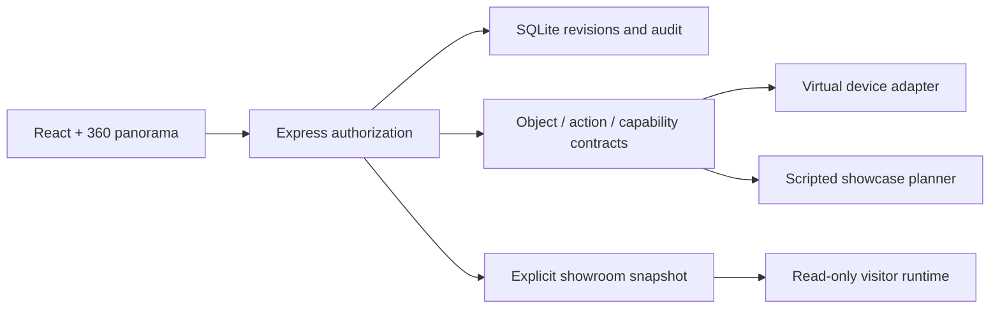

# Architecture

Private Home and the public-viewer model share presentation components, not
provider command authority. Demo startup uses only the included public CC0
media and synthetic object model. External adapters remain inspectable source,
but receive no credentials and cannot make external connections in demo mode.

The historical update fixture contains client source only. Installer tests
operate on disposable folders, a fake service manager and local HTTP fixtures;
they do not target the owner's original installation.
